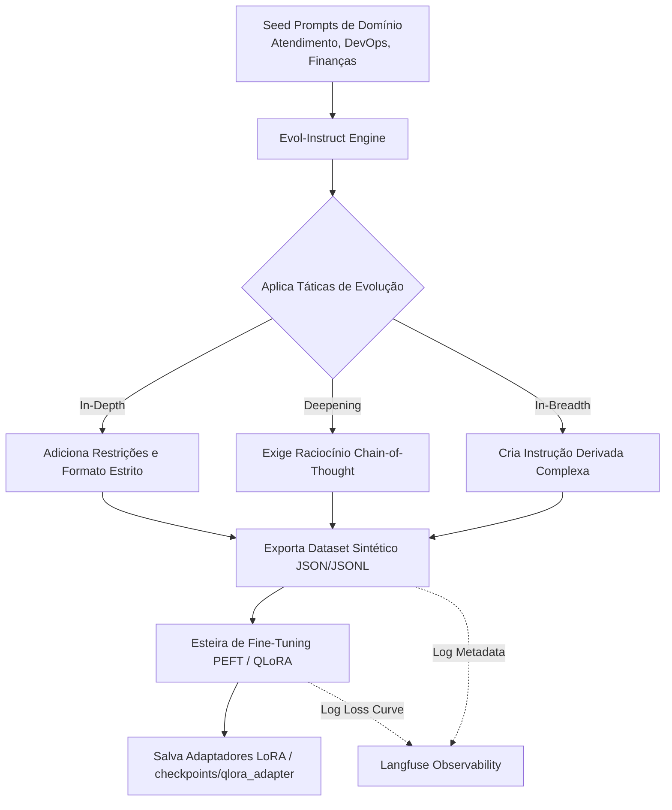

# LLM Synthetic Data & Fine-Tuning PEFT/QLoRA Suite 🧬⚡


> Pipeline de **Geração de Dados Sintéticos** via técnicas **Evol-Instruct (In-Depth & In-Breadth)** e Esteira de **Fine-Tuning PEFT / QLoRA** para modelos SLM/LLM locais com Rastreamento no Langfuse.

---

## 🧭 Visão Geral

O **`llm-synthetic-data`** atende à necessidade de escalar datasets de alta qualidade quando dados reais são escassos ou sensíveis:
1. **Geração de Dados Sintéticos (Evol-Instruct)**: Muta instruções base adicionando restrições de formato estrito (JSON/pydantic), cenários de raciocínio lógico profundo (Chain-of-Thought) e casos de borda.
2. **Esteira de Fine-Tuning PEFT/QLoRA**: Configuração parametrizada de adaptadores LoRA (`q_proj`, `k_proj`, `v_proj`, `o_proj`) com $r=16$ e $\alpha=32$ para ajuste eficiente de pesos em GPUs/CPUs locais.
3. **Exportação & Quantização**: Formata e exporta checkpoints de adaptadores prontos para conversão em formato GGUF para o servidor Ollama.

---

## 🏗️ Arquitetura do Pipeline Sintético & Treinamento



---

## 🚀 Como Executar

### 1. Execução dos Testes e Pipeline em Docker
```bash
docker run --rm -e PYTHONPATH=/app -v $(pwd):/app -w /app python:3.12-slim bash -c "pip install pytest pytest-cov pydantic pydantic-settings langfuse && pytest --cov=app --cov-report=term-missing"
```

### 2. Execução Local
```bash
pip install -e .[dev]
make test
```

---

## 🛡️ Licença & Autor
Desenvolvido por **Cayo Neves** ([@cayoesn](https://github.com/cayoesn)) como parte do Portfólio de LLM & LLMOps de Alta Performance.


---

## 🚀 Execução em Container Isolado (100% Autônomo)

Este repositório é **100% independente e autônomo**. Ele não depende de nenhum outro projeto do ecossistema para ser executado, testado ou analisado.

### 🛠️ Componentes Inclusos na Stack Docker Exclusiva:
- `synthetic_data_app`: Pipeline Evol-Instruct e Treinamento PEFT/QLoRA.
- `synthetic_data_postgres`: Banco de dados PostgreSQL dedicado (porta 5438).
- `synthetic_data_langfuse`: Servidor de observabilidade Langfuse self-hosted pré-inicializado.

### 📦 Como Executar:

1. **Subir toda a pilha isolada**:
   ```bash
   docker-compose up -d --build
   ```

2. **Endpoints & Endereços de Acesso**:
   - **Serviço da Aplicação**: `Job Container (data/checkpoints)` (Documentação interativa OpenAPI em `/docs` se aplicável)
   - **Painel de Observabilidade (Langfuse)**: `http://localhost:3007`
   - **Credenciais Automáticas do Langfuse**:
     - Email: `admin@llmsyntheticdata.com`
     - Senha: `adminpassword123`

3. **Execução de Testes Automatizados em Container**:
   ```bash
   make test
   ```

4. **Encerrar a pilha**:
   ```bash
   docker-compose down -v
   ```
